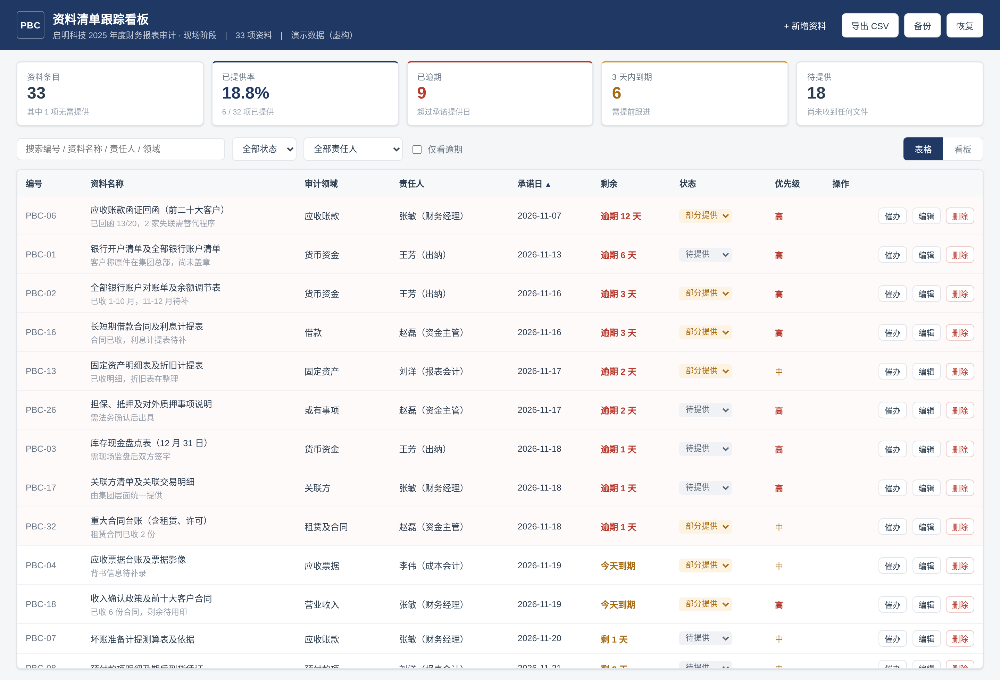
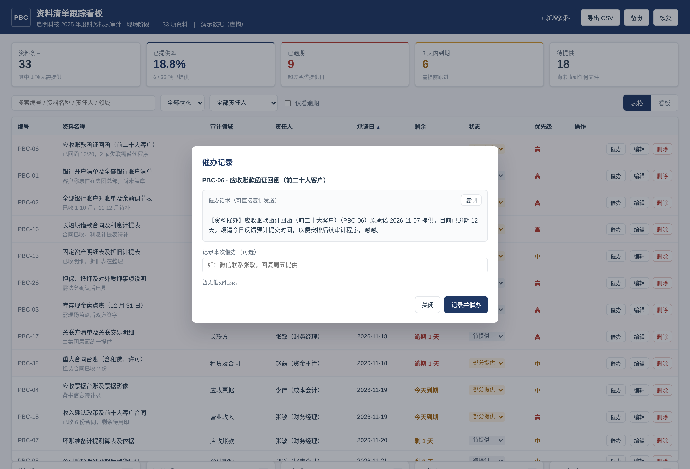
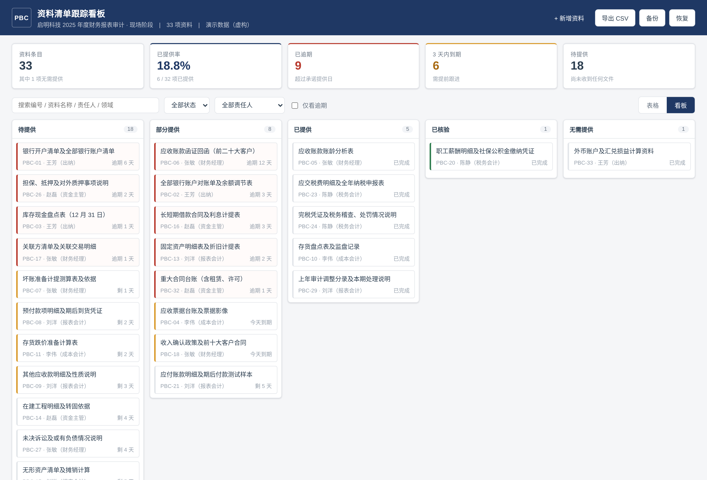

# PBC 资料清单跟踪看板

审计现场等客户资料，最烦的不是催，是**忘了催谁、催到第几次、客户答应哪天给**。

这个小工具把 PBC（Prepared By Client）清单变成一块看板：谁负责、什么时候到期、逾期几天、催了几次，一眼看到。



---

## 一、功能

**核心**
- 资料条目管理：编号、资料名称、审计领域、客户责任人、请求日、承诺提供日、状态、优先级、备注
- 五种状态：待提供 / 部分提供 / 已提供 / 已核验 / 无需提供
- 逾期与临期自动识别：逾期标红、3 天内到期标黄，不用自己算日子
- 两种视图：表格（看细节和排序）/ 看板（按状态看全局）

**催办**
- 点"催办"自动生成一段话术，可直接复制发微信或邮件
- 话术按情况变：已逾期写"原承诺 X 提供，已逾期 N 天"；临期写"还有 N 天"；已收到写确认
- 每次催办留一条记录（时间 + 备注），下次打开能看到已经催过几次



**数据**
- 自动保存在浏览器本地（localStorage），关掉再打开还在
- 导出 CSV（可直接给项目经理汇总，或粘进 Excel）
- 导出/恢复 JSON 备份，换电脑或清缓存不丢数据

## 二、怎么用

**方式一：直接打开**

双击 `index.html` 即可，不需要装任何东西，不需要服务器。

**方式二：放到 GitHub Pages**

```bash
git add .
git commit -m "PBC tracker"
git push
# 仓库 Settings → Pages → Branch: main / root → Save
# 访问 https://<用户名>.github.io/<仓库名>/
```

**方式三：给同事用**

把整个文件夹（`index.html` + `styles.css` + `app.js`）打包发过去，对方双击就能用。数据各自存在本地，互不影响。

## 三、看板视图



按状态分五列，卡片左边框颜色即预警级别（红=逾期、黄=临期、绿=已核验）。点卡片直接进编辑。

## 四、设计取舍

- **不做后端**：审计现场经常在内网、客户不让装软件，一个 HTML 文件 + 本地存储是最不容易被 IT 拦住的形态。
- **不改状态自动化**：催办后不会自动把"待提供"改成"部分提供"——状态代表事实，催办只是动作，混在一起会失真。
- **保留原表式导出**：CSV 表头和列顺序按底稿习惯排，导出后能直接接进汇总表，不用二次整理。
- **不追求花哨**：审计底稿的审美是信息密度，不是动效。

## 五、数据结构

```json
{
  "id": "pbc-1",
  "no": "PBC-01",
  "name": "银行开户清单及全部银行账户清单",
  "cat": "货币资金",
  "owner": "王芳（出纳）",
  "requested": "2026-11-01",
  "due": "2026-11-13",
  "status": "pending",          // pending | partial | received | verified | waived
  "priority": "高",              // 高 | 中 | 低
  "files": 0,
  "note": "客户称原件在集团总部，尚未盖章",
  "followups": [
    { "date": "2026-11-18 10:20", "note": "微信联系，回复周五提供" }
  ]
}
```

备份文件就是 `{ "version": 1, "items": [...] }`，可以直接手改再导入。

## 六、项目结构

```
pbc-tracker/
├── index.html      # 页面结构
├── styles.css      # 样式
├── app.js          # 全部逻辑（无第三方依赖）
└── screenshots/
```

## 七、已知局限

1. 数据存在单台设备的浏览器里，**多人协作需要各自维护自己的清单**；要真正共享得接后端或飞书多维表格。
2. 清浏览器缓存会丢数据，重要数据请定期"备份"。
3. 目前不含文件上传，只记录"提供了几份"，附件本身还在客户邮箱/共享盘里。

---

**数据说明**：界面内的项目名、人名、资料条目均为虚构示例，用于演示，不代表任何真实客户。
